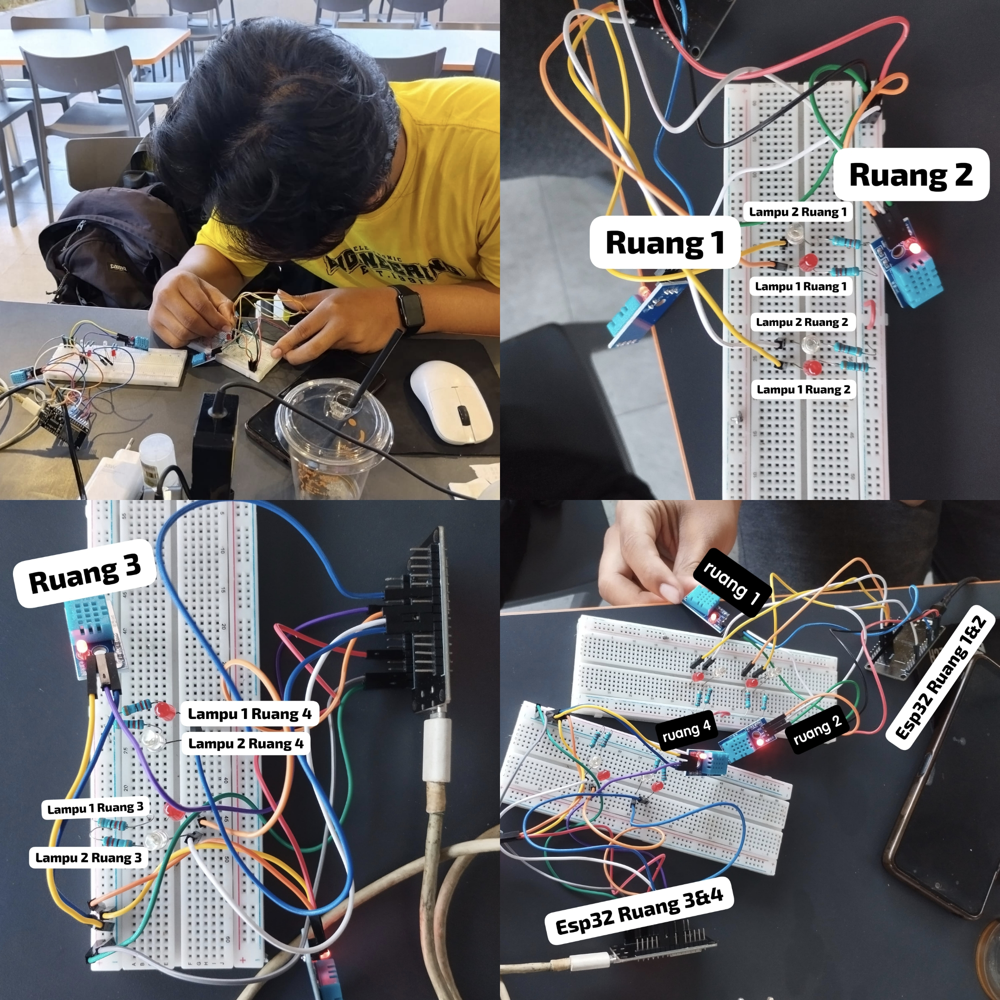
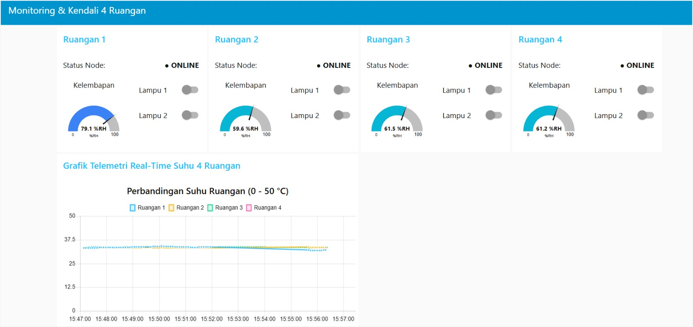

# Kel6-TugasNodeRED-ESP32

> **Evaluasi Mata Kuliah Jaringan Sensor dan IoT — Politeknik Elektronika Negeri Surabaya (PENS)**  
> **Materi:** Node-RED dan ESP32 (Lanjutan Komunikasi MQTT pada ESP32)  
> **Dosen Pengampu:** Akhmad Hendriawan, S.T., M.T.

Sistem telemetri multi-ruangan cerdas dan kendali aktuator terdistribusi berbasis protokol **Message Queuing Telemetry Transport (MQTT)** menggunakan mikrokontroler ESP32 (**FreeRTOS Dual-Task**) dan dashboard visual **Node-RED**. Sistem ini memantau kondisi lingkungan secara real-time pada 4 ruangan terpisah menggunakan **4 unit sensor fisik DHT11** (suhu dan kelembapan) serta mengendalikan **8 lampu indikator LED** secara presisi dengan jaminan pengiriman pesan **QoS 1** dan fitur pemantauan status koneksi **Last Will and Testament (LWT)**.

---

## License

This project is licensed under the MIT License, See the [LICENSE](LICENSE) file for details.

---

## 📹 Tautan Video Kelompok

Sesuai ketentuan evaluasi, berikut adalah dokumentasi video pengerjaan proyek Kelompok 6:

* 🎬 **[Tautan Video Demo Alat (Google Drive)](https://drive.google.com/file/d/1HhSpIJHn7SjSMZfvVB8ZDLf64A37hRlt/view?usp=sharing)** — Memperlihatkan pengujian fungsional terpadu (T2, T3, T5, T7, T9, T10, T11, T12) dengan layar dashboard dan perangkat fisik tampak dalam satu frame.
* 🎥 **[Tautan Video Presentasi Kelompok (Google Drive)](link video presentasi)** — Pemaparan materi lengkap, arsitektur sistem, penjelasan firmware ESP32, flow Node-RED, serta kendala dan solusi oleh seluruh anggota kelompok.

*(Tautan juga terdokumentasi pada berkas `video/LINK.md`)*.

---

## 👥 Anggota Kelompok 6 (Kelas 3 D4 Elektronika D)

| Ruangan | Nama Anggota | NRP | Tanggung Jawab & Alokasi Hardware | Akun GitHub |
| :---: | :--- | :---: | :--- | :---: |
| **Ruang 1** | **Enzillana Afwa** | `2124600092` | ESP32 #1: DHT11 (GPIO 4), LED 1 (GPIO 25), LED 2 (GPIO 26) | [@Enzillana](https://github.com/Enzillana) |
| **Ruang 2** | **Syauqi Fardi Sya'bani** | `2124600099` | ESP32 #1: DHT11 (GPIO 21), LED 1 (GPIO 27), LED 2 (GPIO 32) | [@viefemm](https://github.com/viefemm) |
| **Ruang 3** | **Farrel Putra Ardiansyah** | `2124600116` | ESP32 #2: DHT11 (GPIO 4), LED 1 (GPIO 25), LED 2 (GPIO 26) | [@frpaa](https://github.com/frpaa) |
| **Ruang 4** | **Rara Kissya Erbianti** | `2124600119` | ESP32 #2: DHT11 (GPIO 21), LED 1 (GPIO 27), LED 2 (GPIO 32), BOOT (GPIO 0) | [@ssyashain](https://github.com/ssyashain) |

---

## 🏛️ Arsitektur Sistem

Sistem mengadopsi topologi komunikasi *Publish/Subscribe* MQTT terpusat dengan pembagian kanal upstream (telemetri sensor) dan downstream (kendali saklar lampu):

```text
                           ┌───────────────────────────┐
  ESP32 #1 (Ruang 1 & 2) ──┤                           │
  [2x DHT11 + 4x LED]      │    Broker MQTT Publik     ├──── Node-RED Client ──── Browser UI Dashboard
                           │  (broker.hivemq.com:1883) │     (Port 1880)          http://localhost:1880/ui
  ESP32 #2 (Ruang 3 & 4) ──┤                           │
  [2x DHT11 + 4x LED + LWT]└───────────────────────────┘
  
  [ESP32 -> Broker] Publish  : pens/klp6/ruangN/temperature
                               pens/klp6/ruangN/humidity
                               pens/klp6/ruangN/status (LWT & Retain)
  [Broker -> Node-RED] Sub   : pens/klp6/+/temperature
                               pens/klp6/+/humidity
                               pens/klp6/+/status
  [Node-RED -> ESP32] Pub/Sub: pens/klp6/ruangN/lamp1 (QoS 1)
                               pens/klp6/ruangN/lamp2 (QoS 1)
```

1. **Mikrokontroler ESP32:** Dua board ESP32 masing-masing menjalankan dua task independen berbasis FreeRTOS (`roomTask`). Setiap task mengelola koneksi socket TCP, client ID unik, pembacaan sensor DHT11 tiap 5 detik, serta *callback listener* aktuator lampu.
2. **Broker MQTT Publik:** Menggunakan HiveMQ Public Broker (`broker.hivemq.com:1883`) dengan prefix kelompok khusus `pens/klp6/` sehingga terisolasi penuh dari lalu lintas pengguna lain.
3. **Node-RED Client & Dashboard:** Berjalan secara lokal di laptop pada port 1880, mengolah telemetri mentah menjadi visualisasi grafis (line chart suhu 4 ruangan, 4 gauge kelembapan, indikator status koneksi), dan mengirimkan perintah saklar 8 lampu ber-QoS 1.

---

## 🔌 Perangkat Keras dan Rangkaian

### Daftar Komponen
* 2 unit Board **ESP32 DevKit V1** (30 pin / 38 pin).
* 4 unit **Sensor Digital Suhu & Kelembapan DHT11** fisik (bukan simulasi potensio).
* 8 buah **LED 5mm** (4 LED Merah untuk Lampu 1, 4 LED Hijau untuk Lampu 2).
* 8 buah **Resistor 220 Ω** (pembatas arus LED).
* 2 buah **Breadboard** 830 titik dan kabel *jumper jumper* secukupnya.
* 1 tombol **BOOT bawaan ESP32** (GPIO 0 pada ESP32 #2) untuk simulasi cabut daya / LWT Ruang 4.

### Tabel Alokasi Pin ESP32

| Komponen Hardware | Pin GPIO | Alokasi pada ESP32 #1 (`main12.cpp`) | Alokasi pada ESP32 #2 (`main34.cpp`) | Keterangan Rangkaian |
| :--- | :---: | :--- | :--- | :--- |
| **DHT11 Unit A (Data)** | **GPIO 4** | Sensor Ruang 1 (Enzillana) | Sensor Ruang 3 (Farrel) | VCC ke 3V3, GND ke GND, Data ke GPIO 4 |
| **LED Lampu 1A (Merah)** | **GPIO 25** | `ruang1/lamp1` | `ruang3/lamp1` | Anoda ke GPIO 25, katoda via resistor 220 Ω ke GND |
| **LED Lampu 2A (Hijau)** | **GPIO 26** | `ruang1/lamp2` | `ruang3/lamp2` | Anoda ke GPIO 26, katoda via resistor 220 Ω ke GND |
| **DHT11 Unit B (Data)** | **GPIO 21** | Sensor Ruang 2 (Syauqi) | Sensor Ruang 4 (Rara) | VCC ke 3V3, GND ke GND, Data ke GPIO 21 |
| **LED Lampu 1B (Merah)** | **GPIO 27** | `ruang2/lamp1` | `ruang4/lamp1` | Anoda ke GPIO 27, katoda via resistor 220 Ω ke GND |
| **LED Lampu 2B (Hijau)** | **GPIO 32** | `ruang2/lamp2` | `ruang4/lamp2` | Anoda ke GPIO 32, katoda via resistor 220 Ω ke GND |
| **Tombol BOOT Fisik** | **GPIO 0** | *(Tidak dipakai)* | Simulasi Cabut Daya Ruang 4 | Memutus paksa TCP Ruang 4 untuk uji LWT T9 |

### Foto Rangkaian dan Dokumentasi Perakitan

| Foto Rangkaian Breadboard | Dokumentasi Perakitan Tim |
| :---: | :---: |
|  |  |
| *Rangkaian 2 ESP32, 4 sensor DHT11, dan 8 lampu LED* | *Proses verifikasi kabel konektor dan sensor bersama tim* |

---

## 📡 Rancangan Topik MQTT Final

* **Broker Host:** `broker.hivemq.com`
* **Port TCP:** `1883` (Non-TLS)
* **Prefix Topik:** `pens/klp6/`

| Topik Final | Arah Alir Data | Format & Tipe Payload | QoS | Retain | Justifikasi Teknis |
| :--- | :---: | :--- | :---: | :---: | :--- |
| `pens/klp6/ruangN/temperature` | ESP32 → Node-RED | Numerik string °C 1 desimal (mis. `"28.5"`) | 0 | `false` | Publikasi berkala tiap 5 detik dari sensor DHT11. |
| `pens/klp6/ruangN/humidity` | ESP32 → Node-RED | Numerik string %RH 1 desimal (mis. `"65.0"`) | 0 | `false` | Publikasi berkala tiap 5 detik dari sensor DHT11. |
| `pens/klp6/ruangN/lamp1` | Node-RED → ESP32 | String `"1"` (nyala) atau `"0"` (mati) | 1 | `false` | Kendali Lampu 1 (LED Merah) bergaransi sampai (QoS 1). |
| `pens/klp6/ruangN/lamp2` | Node-RED → ESP32 | String `"1"` (nyala) atau `"0"` (mati) | 1 | `false` | Kendali Lampu 2 (LED Hijau) bergaransi sampai (QoS 1). |
| `pens/klp6/ruangN/status` | ESP32 / Broker | String `"online"` atau `"offline"` | 0 | `true` | Status aktif perangkat via retained message & LWT. |

*Keterangan: Huruf `N` merepresentasikan nomor ruangan (`ruang1`, `ruang2`, `ruang3`, `ruang4`).*

### Wildcard Subscribe pada Node-RED (`mqtt in`)
* **Suhu 4 Ruangan:** `pens/klp6/+/temperature`
* **Kelembapan 4 Ruangan:** `pens/klp6/+/humidity`
* **Status Koneksi 4 Ruangan:** `pens/klp6/+/status`
* **Seluruh Topik Kelompok (Audit/Debug):** `pens/klp6/#`

---

## 🚀 Panduan Menjalankan Sistem

### 1. Persiapan dan Unggah Kode Firmware ESP32

#### Pustaka Arduino / PlatformIO yang Dibutuhkan:
* `PubSubClient` oleh Nick O'Leary (v2.8+)
* `DHT sensor library` oleh Adafruit (v1.4+)
* `Adafruit Unified Sensor` oleh Adafruit

#### Opsi A: Menggunakan PlatformIO (VS Code) — Direkomendasikan
1. Buka folder repositori ini di VS Code.
2. Navigasikan ke folder `esp32/esp32_ruang12/` (atau `esp32/esp32_ruang34/`).
3. Salin berkas `include/secrets.h.example` menjadi `include/secrets.h`, lalu masukkan kredensial Wi-Fi Anda:
   ```c
   #define SECRET_WIFI_SSID "NAMA_WIFI_ANDA"
   #define SECRET_WIFI_PASS "PASSWORD_WIFI_ANDA"
   ```
4. Pilih environment board pada status bar PlatformIO:
   * **`env:esp32_ruang12`** untuk mengunggah ke **ESP32 #1** (Ruang 1 & Ruang 2).
   * **`env:esp32_ruang34`** untuk mengunggah ke **ESP32 #2** (Ruang 3 & Ruang 4).
5. Klik ikon **Build (✓)** lalu **Upload (→)**.

#### Opsi B: Menggunakan Arduino IDE
1. Buka berkas `esp32/esp32_ruang12/esp32_ruang12.ino` untuk board pertama, atau `esp32/esp32_ruang34/esp32_ruang34.ino` untuk board kedua.
2. Salin template kredensial atau sesuaikan konstanta `WIFI_SSID` dan `WIFI_PASS`.
3. Pilih board **DOIT ESP32 DEVKIT V1**, pilih COM port yang sesuai, lalu klik **Upload**.

---

### 2. Konfigurasi dan Menjalankan Node-RED

1. **Jalankan Server Node-RED:**  
   Buka terminal/PowerShell dan jalankan perintah:
   ```bash
   node-red
   ```
2. **Pasang Palet Dashboard:**  
   Buka peramban ke alamat `http://localhost:1880`.  
   Buka menu pojok kanan atas (**≡**) $\rightarrow$ **Manage palette** $\rightarrow$ tab **Install** $\rightarrow$ cari dan pasang `node-red-dashboard`.
3. **Import Flow Kelompok 6:**  
   * Klik menu (**≡**) $\rightarrow$ **Import**.
   * Klik tombol **Select a file to import** dan arahkan ke berkas `node-red/flows.json` yang ada di repositori ini.
   * Pilih opsi *Import to: new flow* atau *current flow*, lalu klik **Import**.
4. **Deploy Flow:**  
   Klik tombol merah **Deploy** di pojok kanan atas workspace Node-RED.
5. **Buka UI Dashboard:**  
   * Akses dari laptop: **`http://localhost:1880/ui`**
   * Akses dari smartphone (jaringan Wi-Fi/Hotspot yang sama): **`http://<IP_LAPTOP>:1880/ui`** *(contoh: `http://192.168.10.218:1880/ui`)*.

---

## 🖥️ Dokumentasi Node-RED Flow & Dashboard

### Tampilan Workspace Flow Node-RED
Seluruh aliran data dikelompokkan rapi ke dalam 4 jalur utama: pembacaan suhu via wildcard `+` menuju satu chart, routing kelembapan via switch menuju 4 gauge, pemilahan status koneksi ke teks, serta 8 switch lampu yang bermuara pada satu node `mqtt out` ber-QoS 1:


### Tampilan Antarmuka Dashboard UI (`/ui`)
Dashboard responsif dengan tema visual modern menampilkan 4 kartu ruangan lengkap dengan status koneksi real-time, pembacaan suhu, gauge kelembapan DHT11, tombol saklar lampu interaktif, serta grafik garis perbandingan suhu multi-ruangan:



---

## 📊 Hasil Pengujian Fungsional Sistem (Skenario T1 s.d. T12)

Pengujian fungsional dilaksanakan secara ketat mengacu pada parameter evaluasi resmi (T1 s.d. T12). Seluruh pengujian berhasil diselesaikan dengan tingkat kelulusan **100%**:

| No | Skenario Uji | Prosedur Pengujian | Hasil Pengamatan Aktual pada Sistem | Status |
| :---: | :--- | :--- | :--- | :---: |
| **T1** | **Koneksi ESP32** | Membuka Serial Monitor ESP32 (baud 115200) saat booting. | ESP32 terhubung ke Wi-Fi dan HiveMQ, mencetak konfirmasi `online`, dan mengirim LWT retain. | **LOLOS (✓)** |
| **T2** | **Data 4 Ruang Simultan** | Menyalakan kedua ESP32 dan memeriksa panel Debug Node-RED. | Data `temperature` dan `humidity` dari 4 ruangan terbit berkala tiap ±5 detik tanpa hilang paket. | **LOLOS (✓)** |
| **T3** | **Chart Suhu 4 Garis** | Membuka `http://localhost:1880/ui` dan memeriksa grafik suhu. | Node `ui_chart` menampilkan 4 kurva garis berbeda dengan nama seri: `Ruang 1`, `Ruang 2`, `Ruang 3`, `Ruang 4`. | **LOLOS (✓)** |
| **T4** | **Respons Sensor DHT11** | Menggenggam fisik sensor DHT11 Ruang 2 (GPIO 21 ESP32 #1). | Hanya kelembapan Ruang 2 yang melonjak (68% $\rightarrow$ 70,2%RH) dan suhunya naik; 3 ruangan lain tetap stabil. | **LOLOS (✓)** |
| **T5** | **Saklar Lampu Tepat Sasaran** | Mengaktifkan saklar Lampu 2 Ruang 3 di dashboard UI. | Pesan `"1"` (QoS 1) terkirim; hanya fisik LED 2 Ruang 3 (GPIO 26 ESP32 #2) yang menyala terang. | **LOLOS (✓)** |
| **T6** | **Mematikan Lampu** | Mematikan saklar Lampu 2 Ruang 3 di dashboard UI. | Pesan `"0"` (QoS 1) terkirim; fisik LED 2 Ruang 3 langsung padam seketika tanpa gangguan ke LED lain. | **LOLOS (✓)** |
| **T7** | **Filter Payload Salah** | Mengirim payload tidak valid (`"ON"` dan `"2"`) ke `pens/klp6/ruang1/lamp1`. | Firmware memfilter panjang pesan (`len != 1`); status LED tidak berubah dan ESP32 tidak mengalami crash. | **LOLOS (✓)** |
| **T8** | **Status Online 4 Ruang** | Mengamati kartu status koneksi pada antarmuka dashboard. | Keempat ruangan (`ruang1` s.d. `ruang4`) secara serentak menampilkan label indikator `online`. | **LOLOS (✓)** |
| **T9** | **Uji Last Will (LWT)** | Menekan tombol BOOT (GPIO 0) ESP32 #2 untuk memutus paksa TCP Ruang 4. | Broker mendeteksi *keep-alive timeout* (±15–22 s) dan menerbitkan LWT; status Ruang 4 otomatis berubah `offline`. | **LOLOS (✓)** |
| **T10** | **Uji Retained Message** | Me-restart server Node-RED (Ctrl+C lalu jalankan ulang) saat Ruang 4 offline. | Begitu Node-RED tersambung kembali, status seluruh ruang langsung muncul instan (`ruang1-3` online, `ruang4` offline). | **LOLOS (✓)** |
| **T11** | **Uji Auto-Reconnect Wi-Fi** | Mematikan Mobile Hotspot selama >10 detik, lalu menyalakannya kembali. | Firmware mendeteksi hilangnya Wi-Fi, menyambung ulang otomatis dalam $\le 5$ s, dan telemetri mengalir normal. | **LOLOS (✓)** |
| **T12** | **Akses Dashboard dari HP** | Membuka `http://<IP_LAPTOP>:1880/ui` melalui browser smartphone Android. | Dashboard tampil responsif dan saklar lampu di layar HP berfungsi penuh menyalakan/mematikan LED fisik. | **LOLOS (✓)** |

---

## 🔄 Penjelasan Ruangan yang Digabung / Disimulasikan

Sesuai ketentuan tugas dan lembar panduan praktikum, laboratorium menyediakan **2 unit board ESP32 DevKit V1 fisik**:
1. **Tidak Ada Data Tiruan / Dummy:** Sistem **tidak menggunakan simulasi data buatan** pada Node-RED. Seluruh 4 ruangan memproses dan membaca **4 unit sensor fisik DHT11** nyata serta mengendalikan **8 buah lampu LED fisik** nyata pada breadboard.
2. **Implementasi Dual-Task FreeRTOS:**
   * **ESP32 #1:** Menjalankan dua *task* RTOS terisolasi: **Ruangan 1** (Enzillana) dan **Ruangan 2** (Syauqi).
   * **ESP32 #2:** Menjalankan dua *task* RTOS terisolasi: **Ruangan 3** (Farrel) dan **Ruangan 4** (Rara).
3. **Isolasi Fitur LWT Ruang 4 (Uji T9):**  
   Agar pemutusan koneksi Ruang 4 tidak mematikan Ruang 3 pada board ESP32 #2, tombol **BOOT (GPIO 0)** diprogram khusus sebagai *simulated power-cut trigger*. Menekan tombol ini akan memanggil `ctxB.net.stop()`, memutus soket TCP Ruang 4 secara tiba-tiba tanpa mengirim pesan `DISCONNECT`, sehingga broker HiveMQ memicu LWT `offline` murni untuk Ruang 4 sementara Ruang 3 tetap `online`.

---

## 🛠️ Kendala yang Dihadapi dan Solusi Rekayasa

1. **Keterbatasan Jumlah ESP32 Fisik (2 Modul untuk 4 Ruangan):**  
   * *Kendala:* Spesifikasi mensyaratkan 4 ruangan mandiri dengan Client ID dan topik terpisah.  
   * *Solusi:* Menerapkan arsitektur multitasking **FreeRTOS** (`xTaskCreatePinnedToCore`) dengan dua objek `RoomContext` terpisah. Akses ke bus I/O diamankan menggunakan `SemaphoreHandle_t ioMutex`.
2. **Isolasi Pengujian LWT Ruang 4 Tanpa Mematikan Ruang 3:**  
   * *Kendala:* Mencabut kabel daya ESP32 #2 akan mematikan kedua ruangan sekaligus.  
   * *Solusi:* Memanfaatkan pin tombol BOOT bawaan (GPIO 0) untuk menutup paksa soket TCP klien Ruang 4 (`ctxB.net.stop()`), mensimulasikan pemadaman listrik sepihak secara sempurna.
3. **Fluktuasi Bacaan Timing Sensor DHT11 (*Single-Wire*):**  
   * *Kendala:* Protokol *single-wire* DHT11 rentan terhadap interupsi tumpukan Wi-Fi, menyebabkan bacaan sesaat bernilai `NaN`.  
   * *Solusi:* Membaca sensor secara non-blocking via `millis()` tiap 5 detik dan menerapkan filter validasi `isnan()`. Apabila bacaan gagal, firmware menahan nilai valid terakhir (*caching*) sehingga tidak mempublikasikan pesan kosong/rusak.
4. **Penyajian 4 Kurva Garis Terpisah pada Satu Node Chart Node-RED:**  
   * *Kendala:* Node `ui_chart` secara bawaan membedakan seri garis berdasarkan `msg.topic` lengkap yang format jalurnya panjang.  
   * *Solusi:* Menempatkan node `function` bertajuk `ambil nama ruang` untuk mengekstrak segmen nama ruangan (`msg.topic.split('/')[2]`), memetakannya ke label legend yang rapi (`Ruang 1` .. `Ruang 4`), serta mengubah payload teks menjadi numerik murni (`parseFloat`).
5. **Pemblokiran Port 1880 saat Akses Dashboard dari Smartphone (Uji T12):**  
   * *Kendala:* Halaman `http://<IP_Laptop>:1880/ui` tidak dapat dibuka dari peramban ponsel.  
   * *Solusi:* Mengubah profil adaptor Wi-Fi laptop menjadi *Private Network* dan menambahkan *Inbound Rule* pada Windows Defender Firewall untuk mengizinkan port TCP 1880.

---

## 🤝 Pembagian Tugas Anggota Kelompok

Pengerjaan tugas diselesaikan secara gotong-royong dengan pembagian peran terstruktur:

| Nama Anggota & NRP | Ruangan | Rincian Kontribusi Teknis & Proyek |
| :--- | :---: | :--- |
| **Enzillana Afwa**<br>`2124600092` | **Ruang 1** | Perakitan hardware Ruang 1 (DHT11 GPIO 4, LED GPIO 25 & 26), penyusunan algoritma pembacaan sensor DHT11 & filter `isnan()`, serta pengujian skenario T1, T2, dan T7. |
| **Syauqi Fardi Sya'bani**<br>`2124600099` | **Ruang 2** | Perakitan hardware Ruang 2 (DHT11 GPIO 21, LED GPIO 27 & 32), perancangan arsitektur Dual-Task FreeRTOS, manajemen repositori GitHub kelompok, serta pengujian respons sensor T4 dan akses HP T12. |
| **Farrel Putra Ardiansyah**<br>`2124600116` | **Ruang 3** | Perakitan hardware Ruang 3 (DHT11 GPIO 4, LED GPIO 25 & 26), penyusunan flow Node-RED (`flows.json`) beserta tata letak visual UI Dashboard, serta pengujian chart suhu T3, saklar lampu T5–T6, dan retained message T10. |
| **Rara Kissya Erbianti**<br>`2124600119` | **Ruang 4** | Perakitan hardware Ruang 4 (DHT11 GPIO 21, LED GPIO 27 & 32, tombol BOOT GPIO 0), implementasi logika LWT dan auto-reconnect ESP32 #2, serta pengujian status online T8, LWT T9, dan pemulihan jaringan T11. |

---

## 📁 Struktur Direktori Repositori

Sesuai dengan ketentuan struktur direktori standar evaluasi:

```text
Kel6-TugasNodeRED-ESP32/
├── README.md                              # Dokumentasi utama proyek (memenuhi 12 kriteria HackMD)
├── .gitignore                             # Pengecualian berkas build, dependensi, dan secrets
├── esp32/
│   ├── esp32_ruang12/                     # Firmware ESP32 #1 (Ruang 1 & Ruang 2)
│   │   ├── esp32_ruang12.ino              # Source code Arduino IDE
│   │   ├── platformio.ini                 # Konfigurasi build PlatformIO
│   │   ├── src/main12.cpp                 # Source code C++ PlatformIO
│   │   └── include/
│   │       └── secrets.h.example          # Template konfigurasi kredensial Wi-Fi
│   └── esp32_ruang34/                     # Firmware ESP32 #2 (Ruang 3 & Ruang 4 + LWT)
│       ├── esp32_ruang34.ino              # Source code Arduino IDE
│       ├── platformio.ini                 # Konfigurasi build PlatformIO
│       ├── src/main34.cpp                 # Source code C++ PlatformIO
│       └── include/
│           └── secrets.h.example          # Template konfigurasi kredensial Wi-Fi
├── node-red/
│   └── flows.json                         # Berkas ekspor konfigurasi seluruh flow dan UI Dashboard
├── docs/
│   ├── Laporan.pdf                        # Berkas laporan lengkap evaluasi proyek
│   └── images/                            # Berkas tangkapan layar, dokumentasi, dan rangkaian
│       ├── Rangkaian.jpg
│       ├── Dokumentasi.jpeg
│       ├── Flow Node-red.jpeg
│       └── Dashboard.jpeg
└── video/
    └── LINK.md                            # Tautan video presentasi dan demo alat
```

---
*Proyek dievaluasi dan diuji pada Semester 5 — Program Studi Sarjana Terapan (D4) Teknik Elektronika, Departemen Teknik Elektro, Politeknik Elektronika Negeri Surabaya (PENS), 2026.*
